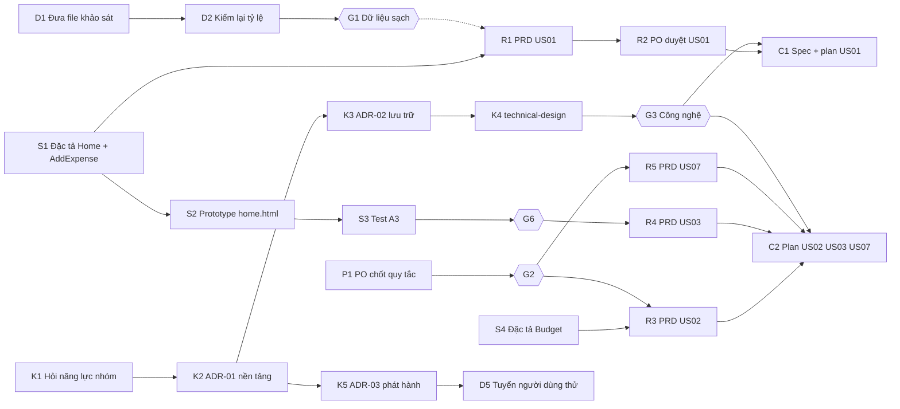

# Kế hoạch tổng thể – thứ tự công việc và lệnh cho AI agent

> **Giai đoạn:** 1 → 5 · **Trạng thái:** Đề xuất – chờ Sprint Planning thống nhất · **Phụ trách:** Trần Ninh Nhật Tân (SM), Dương Văn Hoan (PO) · **Cập nhật:** 20/11/2026

File này trả lời 3 câu hỏi: **làm việc gì trước, việc nào phải chờ việc nào, và ra lệnh cho AI thế nào**. Mọi việc ở đây chỉ sinh ra file `.md` (hoặc prototype HTML); code bắt đầu khi plan của User Story đó được duyệt.

Ngày, người phụ trách lấy từ `docs/discovery/07-roadmap.md` và `docs/skill-standard.md`. Hạn là đề xuất, SM chốt lại ở Sprint Planning.

---

## 1. Hiện trạng ngày 20/11/2026

| Hạng mục | Hiện trạng | Ảnh hưởng |
| :--- | :--- | :--- |
| File khảo sát gốc | `docs/evidence/survey/` **chưa có** `responses.csv`, `questions.md` | Không kiểm chứng được 6 con số khảo sát đang dùng |
| 2 tỷ lệ "lý do bỏ app" | 64% và 42% của 29 người **không ra số nguyên** (`00-research-log.md`) | Giả định A2 chưa kết luận được |
| Phỏng vấn sâu | Số buổi `[điền số]`, chưa có file `PV-xx.md` | Persona chưa có trích dẫn thật |
| Nhật ký chi tiêu 7 ngày | `[điền trạng thái]` | Thiếu mốc so sánh cho A4 |
| Quy tắc chờ PO chốt | Khoản thu cộng vào tháng nào · tháng mới gợi ý ngân sách cũ · cách đo A4 · có thêm HMW4 không | Chặn PRD US02, US07 |
| Công nghệ | Chưa có ADR nào | Chặn mọi plan code |
| Đặc tả màn hình | 4 file ở trạng thái `Cần bổ sung` | Chặn PRD |
| PRD | Chưa có | Chặn plan |
| Lịch | Sprint 1 kết thúc **23/11** (còn 3 ngày) | Xem rủi ro R1 mục 6 |

---

## 2. Cổng chặn – việc này phải xong trước việc kia

| Cổng | Điều kiện | Chặn việc gì |
| :--- | :--- | :--- |
| **G1 – Dữ liệu sạch** | Có `responses.csv`, 2 tỷ lệ đã kiểm lại, `00-research-log.md` cập nhật | Mọi PRD có trích con số người dùng (mục Bối cảnh) |
| **G2 – PO chốt quy tắc** | 4 câu hỏi ở mục 1 có câu trả lời, ghi vào tài liệu | PRD US02, US07; ngưỡng đo A4 |
| **G3 – Công nghệ** | ADR-01, ADR-02 `Đã chấp nhận` + `technical-design.md` | Mọi spec/plan code |
| **G4 – Đặc tả màn hình** | File `docs/design/screens/<ScreenName>.md` ở trạng thái `Xong` | PRD dùng màn hình đó |
| **G5 – PRD duyệt** | PRD `Đã duyệt`, không còn câu hỏi mở | Spec + plan của User Story đó |
| **G6 – Kết quả A3** | Test prototype 5 SV đã có kết quả | PRD US03 (cách hiển thị con số) |
| **G7 – Phát hành** | ADR phát hành bản dùng thử `Đã chấp nhận` | Tuyển người dùng thử, bản build 03/12 |
| **G8 – Thông báo** | ADR thông báo 21:00 `Đã chấp nhận` | PRD US05 |

---

## 3. Sơ đồ phụ thuộc



Nét đứt: nên có, không chặn cứng (PRD US01 viết được trước, nhưng con số trong mục Bối cảnh chỉ điền sau G1).

---

## 4. Danh sách việc theo thứ tự

Mã việc: **D** dữ liệu · **P** quyết định PO · **K** kỹ thuật · **S** thiết kế · **R** yêu cầu (PRD) · **C** plan code · **B** bản build · **T** trình bày.

### 4.1 Sprint 1 – còn lại (20/11 – 23/11): dọn dữ liệu và mở đường cho US01

Ba nhánh chạy song song: **dữ liệu** (D, P) · **công nghệ** (K) · **US01** (S, R).

| Mã | Việc | Skill | Cần có trước | Đầu ra | Phụ trách | Hạn |
| :--- | :--- | :--- | :--- | :--- | :--- | :--- |
| D1 | Đưa bộ câu hỏi và file trả lời khảo sát (đã xoá cột cá nhân) lên repo, viết bản tổng hợp | `user-research` | — | `docs/evidence/survey/questions.md`, `responses.csv`, `summary.md` | Thương, Kiệt | 21/11 |
| D2 | Đếm lại 2 tỷ lệ lý do bỏ app từ `.csv`, sửa ở mọi nơi dùng | `user-research` | D1 | `00-research-log.md`, `02-problem.md`, `05-vision.md` (A2) | Thương, Kiệt | 21/11 |
| D3 | Viết biên bản các buổi phỏng vấn đã làm, thay trích dẫn thật vào Persona | `user-research` | — | `docs/evidence/interviews/PV-xx.md`, `03-personas.md` | Thương, Kiệt | 23/11 |
| D4 | Ghi trạng thái nhật ký chi tiêu 7 ngày (đã làm / chưa làm / bỏ) | `user-research` | — | `00-research-log.md` dòng S3 | Thương, Kiệt | 23/11 |
| P1 | PO trả lời 4 câu: khoản thu cộng vào tháng ghi? · tháng mới gợi ý ngân sách cũ? · đo A4 thế nào? · thêm HMW4? | `product-discovery` | — | `06-journey-features.md`, `05-vision.md`; sửa `budget-logic` mục 4.2 qua Pull Request | Hoan (PO) | 22/11 |
| K1 | Hỏi nhanh 8 Developer: đã từng làm công nghệ nào | `tech-decision` | — | Bảng mục 2 trong ADR-01 | Tân (SM) | 21/11 |
| K2 | Chọn nền tảng app | `tech-decision` | K1 | `docs/architecture/ADR-01-app-platform.md` | Phát, Nghĩa, Bình Minh, Tiến | 22/11 |
| K3 | Chọn cách lưu dữ liệu trên máy | `tech-decision` | K2 | `docs/architecture/ADR-02-local-storage.md` | Bình Minh, Tiến | 22/11 |
| K4 | Viết thiết kế kỹ thuật | `tech-decision` | K2, K3 | `docs/architecture/technical-design.md` | Phát, Nghĩa, Bình Minh, Tiến | 23/11 |
| S1 | Hoàn thiện đặc tả `HomeScreen`, `AddExpenseScreen` (điền chữ còn thiếu) → `Xong` | `design-system` | — | `docs/design/screens/HomeScreen.md`, `AddExpenseScreen.md` | Vy, Hưng | 21/11 |
| S2 | Làm prototype màn hình chính | `design-system` | S1 | `docs/design/prototype/home.html` | Vy, Hưng | 22/11 |
| S3 | Test A3 với 5 SV | `user-research` | S2 | `docs/evidence/prototype-tests/A3-<yyyy-mm-dd>.md`, `05-vision.md` (A3) | Thương, Kiệt | 23/11 (muộn nhất 25/11) |
| R1 | Viết PRD US01 | `product-requirements` | S1 (G1 cho mục Bối cảnh) | `docs/requirements/US01-add-expense.md` | PA | 22/11 |
| R2 | PO duyệt PRD US01 | — | R1 | PRD trạng thái `Đã duyệt` | Hoan (PO) | 23/11 |
| C1 | Spec + plan US01 (chưa code) | `frontend-ui`, `budget-logic`, `brainstorming`, `writing-plans` | R2, G3 | `docs/plans/specs/2026-11-23-US01-add-expense-design.md`, `docs/plans/2026-11-23-US01-add-expense.md` | Phát, Nghĩa, Bình Minh, Tiến | 23/11 |
| T1 | Sprint 1 Review, Sprint 2 Planning | `scrum-sprint` | — | `docs/sprints/sprint-1-review.md`, `sprint-2-planning.md` | Tân (SM) | 23/11 |

### 4.2 Sprint 2 (24/11 – 03/12): ngân sách, con số hôm nay, bản dùng thử

Tài liệu của Sprint 3 cũng viết ngay trong Sprint 2 (dòng in đậm), để Sprint 3 vào code được ngay ngày 04/12.

| Mã | Việc | Skill | Cần có trước | Đầu ra | Phụ trách | Hạn |
| :--- | :--- | :--- | :--- | :--- | :--- | :--- |
| S4 | Đặc tả `BudgetScreen` → `Xong`; thêm chế độ `Thu` vào `AddExpenseScreen` | `design-system` | P1 | `docs/design/screens/BudgetScreen.md`, `AddExpenseScreen.md` | Vy, Hưng | 24/11 |
| R3 | PRD US02 – ngân sách tháng | `product-requirements` | S4, G2 | `docs/requirements/US02-monthly-budget.md` | PA | 25/11 |
| R4 | PRD US03 – hôm nay còn được tiêu | `product-requirements` | G6, `HomeScreen` `Xong` | `docs/requirements/US03-daily-allowance.md` | PA | 25/11 |
| R5 | PRD US07 – ghi khoản thu | `product-requirements` | S4, G2 | `docs/requirements/US07-add-income.md` | PA | 25/11 |
| C2 | Spec + plan US02, US03, US07 | `frontend-ui`, `budget-logic`, `writing-plans` | R3–R5 duyệt, G3 | `docs/plans/…-US02-…md`, `…-US03-…md`, `…-US07-…md` | 4 Developer code | 26/11 |
| K5 | Chọn cách phát hành bản dùng thử | `tech-decision` | K2 | `docs/architecture/ADR-03-trial-distribution.md` | Phát, Nghĩa | 26/11 |
| D5 | Tuyển 20 SV (tối thiểu 5), viết hướng dẫn cài | `user-research` | K5 | `docs/evidence/trial/recruitment.md` (không ghi tên, SĐT) | Thương, Kiệt | 01/12 |
| B1 | Đóng gói bản dùng thử (US01, US02, US03, US07) | `frontend-ui` | US01, US02, US03, US07 Done | Bản build + mục 5 `technical-design.md` | Phát, Nghĩa | 03/12 |
| **K6** | **Chọn cách làm thông báo 21:00** | `tech-decision` | K2 | `docs/architecture/ADR-04-reminder-notifications.md` | Phát, Nghĩa | 01/12 |
| **S5** | **Đặc tả `ReportScreen`; thêm `DonutChart` vào `design-system` mục 4.3** | `design-system` | — | `docs/design/screens/ReportScreen.md`, sửa skill | Vy, Hưng | 01/12 |
| **R6–R8** | **PRD US04, US05, US06** | `product-requirements` | S5 (US04), K6 (US05), `HomeScreen` (US06) | `docs/requirements/US04-…md`, `US05-…md`, `US06-…md` | PA | 03/12 |

### 4.3 Sprint 3 (04/12 – 12/12): báo cáo, nhắc nhở, sửa/xoá, dùng thử, demo

| Mã | Việc | Skill | Cần có trước | Đầu ra | Phụ trách | Hạn |
| :--- | :--- | :--- | :--- | :--- | :--- | :--- |
| C3 | Plan US04, US05, US06 | `frontend-ui`, `budget-logic`, `writing-plans` | R6–R8 duyệt | `docs/plans/…-US04-…md`, `…-US05-…md`, `…-US06-…md` | 4 Developer code | 04/12 |
| D6 | Chạy dùng thử 7 ngày, ghi ngày cập nhật bản build | `user-research` | B1, D5 | `docs/evidence/trial/` | Thương, Kiệt | 04/12 – 10/12 |
| D7 | Tổng hợp kết quả A4 | `user-research` | D6 | `00-research-log.md`, `05-vision.md` (A4) | Thương, Kiệt | 11/12 |
| T2 | Kịch bản demo, báo cáo tổng kết, dàn ý slide | `demo-present` | D7, US Done | `docs/present/demo-script.md`, `final-report.md` | Tân (SM) + mỗi cặp | 12/12 |

---

## 5. Thứ tự User Story và lý do

| Thứ tự | Story | Sprint | Phụ thuộc | Vì sao đứng ở đây |
| :-: | :--- | :--- | :--- | :--- |
| 1 | US01 Ghi khoản chi | 1 | G3 | Tạo mô hình dữ liệu `Transaction` và lớp lưu trữ mà mọi story sau dùng |
| 2 | US02 Ngân sách tháng | 2 | US01 | Không có ngân sách thì không tính được hạn mức ngày |
| 3 | US03 Hôm nay còn được tiêu | 2 | US01, US02, G6 | Cần giao dịch + ngân sách; cách hiển thị phụ thuộc kết quả A3 |
| 4 | US07 Ghi khoản thu | 2 | US01, US03 | Dùng lại màn hình nhập của US01, cộng vào công thức của US03 |
| — | Bản dùng thử | 2 (03/12) | US01, US02, US03, US07 | Dùng thử 7 ngày phải bắt đầu 04/12 |
| 5 | US04 Báo cáo theo danh mục | 3 | US01, `DonutChart` | Must – xếp trước 2 story Should |
| 6 | US06 Sửa/xoá giao dịch | 3 | US01, US03 (TC16) | Should; người dùng thử nhập nhầm sẽ cần |
| 7 | US05 Nhắc 21:00 | 3 | G8 | Should, độc lập với dữ liệu. **PO có thể đẩy lên trước US04** nếu muốn nhắc nhở có tác dụng trong tuần dùng thử (`05-vision.md`, ghi chú A4) |
| — | US08 Xem lịch sử | Nếu kịp | US01 | Should, không có trong lộ trình chính |

---

## 6. Rủi ro lịch

| Mã | Rủi ro | Dấu hiệu | Cách xử lý (PO/SM quyết) |
| :--- | :--- | :--- | :--- |
| R1 | Sprint 1 còn 3 ngày, chưa có công nghệ, PRD, plan → **code US01 khó xong trước 23/11** | Đến 22/11 chưa có ADR-01 | Sprint 1 Review ghi rõ US01 `Chưa xong`; code US01 thành việc đầu tiên của Sprint 2, hoặc PO đổi Sprint Goal Sprint 1 thành "sẵn sàng code US01" |
| R2 | Không tìm lại được file khảo sát gốc | D1 trễ | Ghi `Cần bổ sung` cạnh 6 con số khảo sát; không dùng 2 tỷ lệ chưa kiểm lại trong PRD và slide |
| R3 | A3 không đạt (< 4/5 hiểu) | Kết quả S3 | Sửa nhãn/cách hiển thị trong `HomeScreen.md` trước khi viết PRD US03 |
| R4 | Bản dùng thử trễ 03/12 | US03 chưa xong ngày 01/12 | Phát bản có US01 + US02 trước, cập nhật sau; ghi ngày cập nhật |

---

## 7. Lệnh cho AI agent theo từng loại việc

Dán vào Codex / Antigravity / Claude Code. Mỗi lệnh chỉ sinh file `.md`, **không code**.

**D1 – Tổng hợp khảo sát**
```
Dùng skill user-research. Đọc docs/evidence/survey/responses.csv và questions.md.
Tạo docs/evidence/survey/summary.md theo mẫu survey-summary.md, ghi tử số/mẫu số mọi tỷ lệ.
Đối chiếu với bảng "Kết quả khảo sát S1" trong docs/discovery/00-research-log.md và liệt kê chỗ lệch.
Chưa sửa file discovery – chỉ báo cáo chỗ lệch.
```

**D2 – Sửa con số sau khi kiểm lại**
```
Dùng skill user-research. Theo docs/evidence/survey/summary.md, sửa 2 tỷ lệ "lý do bỏ app"
trong 00-research-log.md, 02-problem.md, 05-vision.md (A2). Liệt kê mọi chỗ đã sửa.
```

**D3 – Biên bản phỏng vấn**
```
Dùng skill user-research. Từ ghi chép phỏng vấn tôi dán dưới đây, tạo docs/evidence/interviews/PV-<xx>.md
theo mẫu interview.md. Bỏ mọi họ tên, SĐT, MSSV. Đề xuất câu trích dẫn cho 03-personas.md kèm mã PV.
<dán ghi chép>
```

**P1 – Ghi quyết định của PO**
```
Dùng skill product-discovery. PO đã chốt: <dán 4 câu trả lời>.
Cập nhật 05-vision.md (A4) và 06-journey-features.md. Liệt kê chỗ cần sửa trong skill budget-logic
mục 4.2 (chưa sửa skill – tôi sẽ mở Pull Request riêng).
```

**K2, K3, K5, K6 – ADR**
```
Dùng skill tech-decision. Viết docs/architecture/ADR-<xx>-<english-slug>.md cho câu hỏi "<câu hỏi>".
Năng lực nhóm: <dán kết quả hỏi nhanh>. Mọi khẳng định kỹ thuật phải có link tài liệu chính thức
và ngày đọc; không có thì ghi "Cần kiểm chứng". Trạng thái để "Đề xuất".
```

**K4 – Thiết kế kỹ thuật**
```
Dùng skill tech-decision. ADR-01 và ADR-02 đã chấp nhận. Viết docs/architecture/technical-design.md
theo mẫu, dẫn tới budget-logic mục 4.1 cho dữ liệu, không định nghĩa lại kiểu dữ liệu.
```

**S1, S4, S5 – Đặc tả màn hình**
```
Dùng skill design-system. Hoàn thiện docs/design/screens/<ScreenName>.md: điền mọi chỗ "Cần bổ sung",
đủ trạng thái có dữ liệu / trống / lỗi, chữ trên màn hình đúng nguyên văn. Chỉ dùng component mục 4.3.
```

**S2 – Prototype**
```
Dùng skill design-system mục 4.5. Tạo docs/design/prototype/home.html từ docs/design/screens/HomeScreen.md,
nhúng token mục 4.2, không tải tài nguyên ngoài, rộng 360px không vỡ.
```

**R1, R3–R8 – PRD**
```
Dùng skill product-requirements. Viết PRD cho US<xx> từ docs/discovery/06-journey-features.md
và docs/design/screens/<ScreenName>.md. Trạng thái "Chờ duyệt". Thêm dòng vào docs/requirements/README.md.
Điều gì chưa rõ thì ghi vào mục "Câu hỏi mở", không tự đoán.
```

**C1–C3 – Spec và plan (chưa code)**
```
Dùng skill frontend-ui. Làm brainstorming rồi writing-plans cho US<xx> theo PRD docs/requirements/US<xx>-<english-slug>.md
và docs/architecture/technical-design.md. Phần đầu plan và Global Constraints theo AGENTS.md mục 3.
Chỉ viết spec và plan, KHÔNG viết code. Cập nhật cột "Plan" trong docs/requirements/README.md.
```

**T1 – Báo cáo Sprint**
```
Dùng skill scrum-sprint. Viết docs/sprints/sprint-<N>-review.md từ git log từ <ngày> đến <ngày>
và danh sách thẻ Trello tôi dán dưới đây. Việc không có bằng chứng ghi "Cần bổ sung".
```

---

## 8. Cập nhật file này

- SM cập nhật cột "Hạn" sau mỗi Sprint Planning.
- Việc xong: giữ nguyên dòng, ghi đường dẫn file đầu ra thật vào cột "Đầu ra".
- Thêm việc mới: chọn mã tiếp theo, ghi rõ "Cần có trước".
