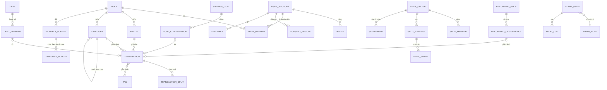
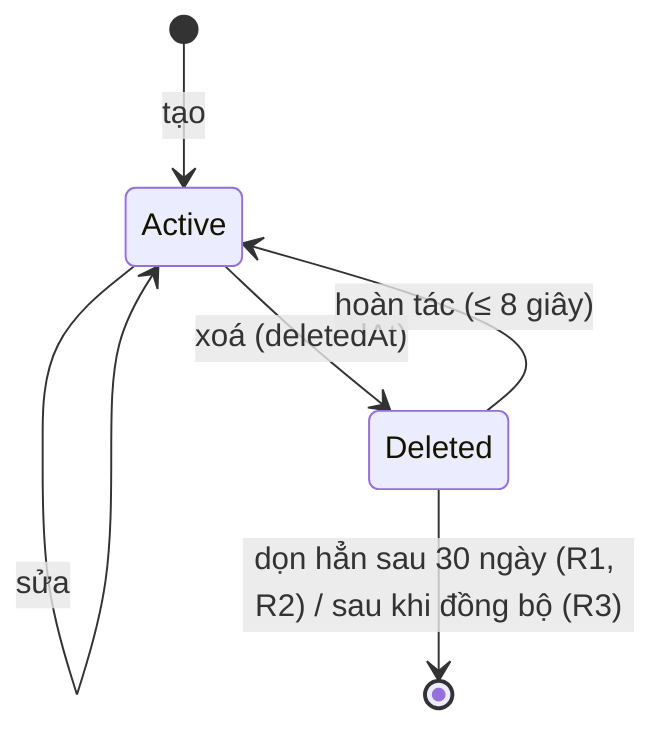
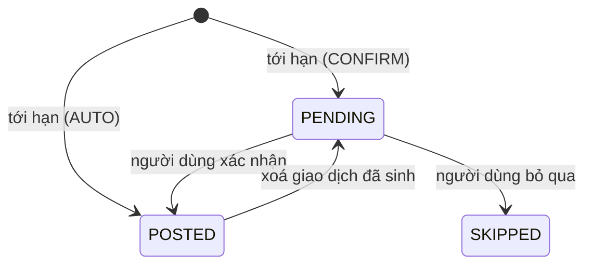
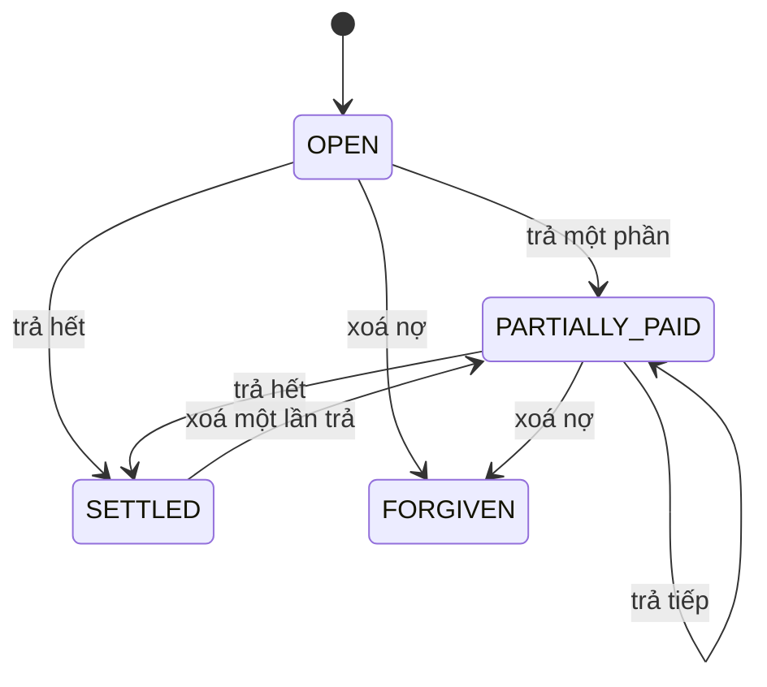

# Phân tích và thiết kế dữ liệu – Ví Khéo

> **Giai đoạn:** 3 – Product Requirements · **Trạng thái:** Đang làm – chờ PO chốt mục 13 · **Phụ trách:** Nguyễn Thị Bình Minh, Nguyễn Diên Tiến (cặp dữ liệu), PA · **Duyệt:** Dương Văn Hoan (PO) · **Cập nhật:** 20/11/2026

## Mục lục

0. Mục đích, phạm vi, cách đọc
1. Nghiên cứu mô hình dữ liệu của sản phẩm tương tự
2. Ba lớp phát hành dữ liệu (R1 – R2 – R3)
3. Sơ đồ thực thể tổng thể
4. Từ điển dữ liệu – R1 (MVP)
5. Từ điển dữ liệu – R2 (mở rộng trên máy)
6. Từ điển dữ liệu – R3 (tài khoản, đồng bộ, trang quản trị)
7. Danh mục giá trị (enum)
8. Quy tắc nghiệp vụ
9. Vòng đời trạng thái
10. Dữ liệu tính ra và công thức
11. Ma trận đọc/ghi theo tính năng
12. Kiểm tra dữ liệu đầu vào và mã lỗi
13. Câu hỏi mở
14. Trường hợp biên
15. Riêng tư, bảo mật, lưu giữ dữ liệu
16. Truy vết: thực thể → tính năng → nhu cầu
17. Ảnh hưởng tới tài liệu khác

---

## 0. Mục đích, phạm vi, cách đọc

File này trả lời: **sản phẩm cần lưu dữ liệu gì, ràng buộc ra sao, nghiệp vụ nào áp lên dữ liệu, tính năng nào đọc/ghi dữ liệu nào** – cho bản MVP và cho các bản mở rộng sau MVP. Đây là đầu vào để:

- PA viết PRD từng User Story (`product-requirements`) – lấy thực thể, ràng buộc, quy tắc, trường hợp biên.
- Kiến trúc sư chọn cách lưu trữ và thiết kế máy chủ (`tech-decision`) – lấy dạng truy vấn (mục 11), yêu cầu đồng bộ (mục 8.11), quản trị (mục 6, 8.12).

| Thuộc file này (mức logic) | Không thuộc file này (mức vật lý – kiến trúc) |
| :--- | :--- |
| Thực thể, thuộc tính, ràng buộc, enum, quy tắc, vòng đời, công thức, nhu cầu đọc/ghi | Chọn SQLite / PostgreSQL / Firebase, tên bảng, chỉ mục, API, cách migration cụ thể |

**Về phạm vi (AGENTS.md quy tắc 3):** chỉ lớp **R1** nằm trong MVP và khớp Backlog đã duyệt (US01–US08). Lớp **R2, R3** là thiết kế trước để MVP không phải làm lại khi mở rộng; **mỗi thực thể R2, R3 chỉ được làm khi có User Story do PO duyệt.** Lớp R3 có đăng nhập và máy chủ – hiện là Won't-have của MVP.

**Nguyên tắc thiết kế:** giao diện vẫn tối giản (ghi một khoản ≤ 3 thao tác); độ phức tạp nằm ở dữ liệu và quy tắc, không đẩy lên màn hình nhập.

**Ký hiệu:** `[THỨ CẤP]` nguồn đã công bố · `[NHẬN ĐỊNH]` ý kiến nhóm · **Đề xuất** = chưa được PO/kiến trúc sư chốt.

---

## 1. Nghiên cứu mô hình dữ liệu của sản phẩm tương tự

Đọc ngày 20/11/2026. Chỉ ghi điều đã đọc được trong nguồn; điều không đọc được ghi rõ.

| # | Nguồn | Điều rút ra cho Ví Khéo |
| :-: | :--- | :--- |
| R-01 | YNAB API, đặc tả OpenAPI chính thức – `https://api.ynab.com/papi/open_api_spec.yaml` `[THỨ CẤP]` | Tiền lưu dạng số nguyên "milliunits" (1.000 = 1 đơn vị tiền) – tránh số thực. Ngày dạng `YYYY-MM-DD`. Mọi thực thể có cờ `deleted` (xoá mềm) để đồng bộ. Đồng bộ theo số `server_knowledge` – máy gửi số đã biết, máy chủ trả phần thay đổi. Giao dịch có `transfer_account_id`, `transfer_transaction_id` (chuyển tiền là 2 giao dịch nối nhau), `subtransactions` (chia một giao dịch thành nhiều danh mục), `import_id` (chống trùng khi nhập), `cleared` = `cleared / uncleared / reconciled`. Giao dịch định kỳ có `date_first`, `date_next`, `frequency` (`never, daily, weekly, everyOtherWeek, twiceAMonth, every4Weeks, monthly, everyOtherMonth, every3Months, every4Months, twiceAYear, yearly, everyOtherYear`). Danh mục có `budgeted`, `activity`, `balance` và mục tiêu (`goal_type`: `TB, TBD, MF, NEED`; `goal_target`, `goal_target_date`, `goal_percentage_complete`). Tháng có `income`, `budgeted`, `activity`, `to_be_budgeted`. Tài khoản nợ có `debt_original_balance`, `debt_interest_rates`, `debt_minimum_payments`; giao dịch nợ có `debt_transaction_type` (`payment, refund, fee, interest, escrow, balanceAdjustment`). Loại tài khoản: `checking, savings, cash, creditCard, lineOfCredit, otherAsset, otherLiability, mortgage, autoLoan, studentLoan, personalLoan, medicalDebt, otherDebt`. |
| R-02 | Actual Budget (mã nguồn mở, lưu trên máy trước) – `packages/loot-core/src/server/sql/init.sql` và thư mục `migrations` trên GitHub `[THỨ CẤP]` | Tiền là `INTEGER`, ngày là `INTEGER`. Mọi bảng có `tombstone` (xoá mềm). Giao dịch có `isParent`, `isChild` (chia nhỏ), `transferred_id` (nối giao dịch chuyển tiền), `starting_balance_flag` (số dư đầu kỳ là một giao dịch), `sort_order`. Tài khoản có `offbudget` (không tính vào ngân sách), `closed`. Danh mục có `is_income`, nhóm danh mục, `hidden`. Có bảng `rules` (điều kiện → hành động), `schedules` (định kỳ), `tags`. Đồng bộ bằng bảng `messages_crdt` (`timestamp`, `dataset`, `row`, `column`, `value`) – ghi từng thay đổi theo cột. Quy ước migration: sau một mốc chỉ được **thêm**, không đổi tên/xoá cột. |
| R-03 | Actual Budget – tài liệu ngân sách phong bì (`actualbudget.org/docs/getting-started/envelope-budgeting`) `[THỨ CẤP]` | Chỉ được phân bổ tiền đã có. Tiền dư của danh mục chuyển sang tháng sau. Chi lố được trừ vào tiền chưa phân bổ của tháng sau và số dư danh mục về 0. Có thể "giữ lại cho tháng sau". |
| R-04 | Sổ Thu Chi MISA – trang chính `sothuchi.misa.vn` `[THỨ CẤP]` | Có: lập hạn mức chi, theo dõi vay nợ, chia sẻ sổ với gia đình/nhóm, xuất Excel/PDF, đồng bộ đám mây nhiều thiết bị, ghi bằng giọng nói. Không đọc được chi tiết cấu trúc dữ liệu. |
| R-05 | Money Lover – trang chính `moneylover.me` `[THỨ CẤP]` | Có: danh mục chia loại chi/thu, nhắc hoá đơn định kỳ trước hạn, mục tiêu tiết kiệm, quản lý vay nợ và tiến độ trả, nhiều loại tiền tệ, đồng bộ nhiều thiết bị. Trang hỗ trợ trả lỗi 403 – không đọc được chi tiết. |
| — | Firefly III | Trang tài liệu trả lỗi 403 – **không dùng** làm nguồn. |

**Kết luận cho thiết kế:**
1. Số nguyên cho tiền, ngày dạng chuỗi/số nguyên, xoá mềm, đồng bộ theo phần thay đổi – là cách làm chung của R-01, R-02 → áp dụng.
2. Ví (tài khoản tiền), chuyển tiền giữa ví, giao dịch định kỳ, mục tiêu tiết kiệm, vay nợ, hạn mức theo danh mục – cả 3–4 sản phẩm đều có → đưa vào R2.
3. Ngân sách phong bì đầy đủ (R-03) quá nặng cho sinh viên mới tự quản lý tiền (`00-research-log.md` T1: 26,6% đúng câu lập kế hoạch) `[NHẬN ĐỊNH]` → Ví Khéo giữ **một con số "hôm nay còn được tiêu"**, chỉ mượn ý "dành sẵn tiền cho khoản cố định" (mục 10.2).

---

## 2. Ba lớp phát hành dữ liệu

| Lớp | Nội dung | Lưu ở đâu | Điều kiện làm |
| :--- | :--- | :--- | :--- |
| **R1 – MVP** | Giao dịch chi/thu, ngân sách tháng, 6 danh mục cố định, cài đặt nhắc nhở, phiên bản dữ liệu | Trên máy | Backlog US01–US08 đã duyệt |
| **R2 – Mở rộng trên máy** | Ví và chuyển tiền, danh mục tự tạo, hạn mức theo danh mục, giao dịch định kỳ (tiền trọ, điện nước), mục tiêu tiết kiệm, vay nợ bạn bè, nhãn, chia tiền nhóm, sao lưu/xuất file | Trên máy | User Story mới do PO duyệt |
| **R3 – Tài khoản và máy chủ** | Tài khoản người dùng, thiết bị, đồng bộ, sổ chia sẻ, trang quản trị (quản trị viên, phân quyền, nhật ký, cấu hình, thông báo, góp ý, thống kê gộp, đồng ý xử lý dữ liệu, yêu cầu xoá dữ liệu) | Máy + máy chủ | Ngoài MVP; cần quyết định sản phẩm và pháp lý |

---

## 3. Sơ đồ thực thể tổng thể



R1 chỉ dùng: `TRANSACTION`, `MONTHLY_BUDGET`, `CATEGORY` (cố định), `SETTINGS`, `APP_META` (2 thực thể cuối không vẽ vì không có quan hệ). Trong R1 không có `BOOK`, `WALLET`: mọi giao dịch ngầm thuộc một sổ, một ví.

**Bảng tổng hợp thực thể**

| Mã | Thực thể | Tên tiếng Việt | Lớp | Lưu / tính / cố định |
| :--- | :--- | :--- | :-: | :--- |
| E01 | `Transaction` | Giao dịch | R1 (mở rộng R2, R3) | Lưu |
| E02 | `MonthlyBudget` | Ngân sách tháng | R1 | Lưu |
| E03 | `Category` | Danh mục | R1 cố định · R2 tự tạo | Cố định / lưu |
| E04 | `Settings` | Cài đặt | R1 | Lưu |
| E05 | `AppMeta` | Thông tin dữ liệu | R1 | Lưu |
| E06 | `Wallet` | Ví | R2 | Lưu |
| E07 | `TransactionSplit` | Phần chia của giao dịch | R2 | Lưu |
| E08 | `Tag`, `TransactionTag` | Nhãn | R2 | Lưu |
| E09 | `CategoryBudget` | Hạn mức theo danh mục | R2 | Lưu |
| E10 | `RecurringRule` | Quy tắc định kỳ | R2 | Lưu |
| E11 | `RecurringOccurrence` | Lần phát sinh định kỳ | R2 | Lưu |
| E12 | `SavingsGoal` | Mục tiêu tiết kiệm | R2 | Lưu |
| E13 | `GoalContribution` | Lần góp vào mục tiêu | R2 | Lưu |
| E14 | `Debt` | Khoản vay / cho vay | R2 | Lưu |
| E15 | `DebtPayment` | Lần trả nợ | R2 | Lưu |
| E16 | `SplitGroup`, `SplitMember` | Nhóm chia tiền, thành viên | R2 | Lưu |
| E17 | `SplitExpense`, `SplitShare` | Khoản chung, phần mỗi người | R2 | Lưu |
| E18 | `Settlement` | Thanh toán trong nhóm | R2 | Lưu |
| E19 | `BackupRecord` | Lần sao lưu / xuất file | R2 | Lưu |
| E20 | `UserAccount` | Tài khoản người dùng | R3 | Lưu (máy chủ) |
| E21 | `Device` | Thiết bị | R3 | Lưu (máy chủ) |
| E22 | `Book`, `BookMember` | Sổ, thành viên sổ | R3 | Lưu |
| E23 | `SyncState` | Trạng thái đồng bộ | R3 | Lưu (máy) |
| E24 | `AdminUser`, `AdminRole` | Quản trị viên, vai trò | R3 | Lưu (máy chủ) |
| E25 | `AuditLog` | Nhật ký thao tác | R3 | Lưu (máy chủ) |
| E26 | `SystemCategory` | Danh mục mặc định toàn hệ thống | R3 | Lưu (máy chủ) |
| E27 | `AppConfig` | Cấu hình, cờ tính năng | R3 | Lưu (máy chủ) |
| E28 | `Announcement` | Thông báo từ quản trị | R3 | Lưu (máy chủ) |
| E29 | `Feedback` | Góp ý, báo lỗi | R3 | Lưu (máy chủ) |
| E30 | `DailyMetric` | Thống kê gộp theo ngày | R3 | Lưu (máy chủ) |
| E31 | `ConsentRecord` | Đồng ý xử lý dữ liệu | R3 | Lưu (máy chủ) |
| E32 | `DataRequest` | Yêu cầu xuất / xoá dữ liệu | R3 | Lưu (máy chủ) |

---

## 4. Từ điển dữ liệu – R1 (MVP)

Quy ước chung cho mọi thực thể được lưu (từ R1):

| Trường chung | Kiểu | Quy tắc |
| :--- | :--- | :--- |
| `id` | UUID | Máy sinh, không đổi, không dùng số tự tăng (đồng bộ R3 không trùng) |
| `createdAt` | Thời điểm ISO 8601 có múi giờ | Không đổi sau khi tạo |
| `updatedAt` | Thời điểm ISO 8601 | Cập nhật mỗi lần sửa; bằng `createdAt` khi tạo |
| `deletedAt` | Thời điểm hoặc rỗng | **Đề xuất** cho R1 (xoá mềm – Q6). Rỗng = đang dùng |

### E01 `Transaction` – Giao dịch

| Trường | Kiểu | Bắt buộc | Ràng buộc | Mặc định | Lớp |
| :--- | :--- | :-: | :--- | :--- | :-: |
| `type` | enum `TransactionType` (mục 7) | Có | R1 chỉ `EXPENSE`, `INCOME` | `EXPENSE` | R1 |
| `amount` | Số nguyên VND | Có | 1 ≤ amount ≤ 99.999.999; luôn dương, dấu thể hiện bằng `type` | — | R1 |
| `categoryId` | Mã danh mục | Có với `EXPENSE`; rỗng với `INCOME` (R1) | Phải tồn tại và đang dùng | `an_uong` | R1 |
| `note` | Văn bản | Không | ≤ 100 ký tự sau khi bỏ khoảng trắng đầu/cuối | — | R1 |
| `date` | Ngày `YYYY-MM-DD` theo giờ máy | Có | R1: luôn là hôm nay khi tạo, không sửa; R2: cho chọn ngày ≤ hôm nay | Hôm nay | R1 |
| `walletId` | Mã ví | R2: có | Ví đang mở | Ví mặc định | R2 |
| `transferPeerId` | Mã giao dịch | Chỉ với `TRANSFER_OUT/IN` | Trỏ tới giao dịch đối ứng; 2 bên trỏ nhau | — | R2 |
| `excludeFromReport` | Có/Không | Không | Không tính vào báo cáo danh mục (vẫn tính số dư ví) | Không | R2 |
| `source` | enum `TransactionSource` | Có | Nguồn tạo giao dịch | `MANUAL` | R2 |
| `recurringOccurrenceId` | Mã | Không | Khi sinh từ định kỳ | — | R2 |
| `debtId` | Mã | Không | Khi là giao dịch vay/trả nợ | — | R2 |
| `goalId` | Mã | Không | Khi là giao dịch góp mục tiêu | — | R2 |
| `hasSplits` | Có/Không | Có | `true` thì `categoryId` rỗng, phần chia ở E07 | Không | R2 |
| `importKey` | Văn bản | Không | Duy nhất theo ví; chống nhập trùng khi khôi phục/nhập file (theo R-01 `import_id`) | — | R2 |
| `createdBy` | Mã người dùng | R3 | Người ghi trong sổ chia sẻ | — | R3 |

### E02 `MonthlyBudget` – Ngân sách tháng

| Trường | Kiểu | Bắt buộc | Ràng buộc | Lớp |
| :--- | :--- | :-: | :--- | :-: |
| `month` | `YYYY-MM` | Có | **Duy nhất** (theo sổ ở R3) | R1 |
| `amount` | Số nguyên VND | Có | 1 ≤ amount ≤ 99.999.999 (**Đề xuất**, Q3) | R1 |
| `source` | enum `BudgetSource` | Có | `MANUAL` hoặc `COPIED_FROM_PREVIOUS` (Q2) | R1 |
| `reserveFixedCosts` | Có/Không | Có | Bật thì trừ trước khoản cố định dự kiến (mục 10.2) | R2 |

### E03 `Category` – Danh mục

| Trường | Kiểu | Bắt buộc | Ràng buộc | Lớp |
| :--- | :--- | :-: | :--- | :-: |
| `id` | Chuỗi | Có | R1: 6 mã cố định (bảng dưới) – không bao giờ đổi; R2: UUID cho danh mục tự tạo | R1 |
| `kind` | enum `CategoryKind` | Có | `EXPENSE` hoặc `INCOME` | R1 |
| `name` | Văn bản | Có | 1–30 ký tự; duy nhất trong cùng `kind` và cùng cha | R1 |
| `iconKey` | Chuỗi | Có | Thuộc bộ icon trong `design-system` | R1 |
| `sortOrder` | Số nguyên | Có | Thứ tự hiển thị | R1 |
| `isSystem` | Có/Không | Có | Danh mục hệ thống không xoá được, chỉ ẩn được (R2) | R1 |
| `parentId` | Mã danh mục | Không | Tối đa 2 cấp; cha và con cùng `kind` | R2 |
| `hidden` | Có/Không | Có | Ẩn khỏi màn nhập, giữ trong báo cáo cũ | R2 |

| Thứ tự | `id` | `kind` | Tên |
| :-: | :--- | :--- | :--- |
| 1 | `an_uong` | EXPENSE | Ăn uống (mặc định) |
| 2 | `di_chuyen` | EXPENSE | Di chuyển |
| 3 | `nha_tro` | EXPENSE | Nhà trọ & Điện nước |
| 4 | `hoc_tap` | EXPENSE | Học tập & Tài liệu |
| 5 | `mua_sam` | EXPENSE | Mua sắm & Sinh hoạt |
| 6 | `khac` | EXPENSE | Khác |
| 7 | `thu_nhap` | INCOME | Thu nhập (**Đề xuất** – một danh mục thu ngầm định để báo cáo thu ở R2; R1 không hiển thị) |

### E04 `Settings` – Cài đặt (1 bản ghi)

| Trường | Kiểu | Mặc định | Lớp |
| :--- | :--- | :--- | :-: |
| `reminderEnabled` | Có/Không | Q5 | R1 |
| `reminderTime` | `HH:mm` | `21:00` (R1 không cho đổi) | R1 |
| `weekStartsOn` | enum `MONDAY` | `MONDAY` (báo cáo "Tuần này") | R1 |
| `onboardingDoneAt` | Thời điểm | Rỗng | R1 |
| `defaultWalletId` | Mã ví | Ví đầu tiên | R2 |
| `budgetMode` | enum `BudgetMode` | `DAILY_ALLOWANCE` | R2 |

### E05 `AppMeta` – Thông tin dữ liệu (1 bản ghi)

| Trường | Kiểu | Ý nghĩa |
| :--- | :--- | :--- |
| `schemaVersion` | Số nguyên | Bắt đầu `1`; tăng mỗi lần đổi cấu trúc. Chỉ thêm trường, không đổi tên/xoá (theo quy ước R-02) |
| `installId` | UUID | Định danh bản cài đặt, không gắn với người – dùng cho đo A4 nếu PO chọn (Q4) |
| `firstOpenDate` | `YYYY-MM-DD` | Ngày mở app lần đầu – mốc "ngày thứ 7" của A4 |

---

## 5. Từ điển dữ liệu – R2 (mở rộng trên máy)

### E06 `Wallet` – Ví

| Trường | Kiểu | Ràng buộc |
| :--- | :--- | :--- |
| `name` | Văn bản | 1–30 ký tự, duy nhất |
| `type` | enum `WalletType` | `CASH, BANK, EWALLET, SAVINGS, OTHER` |
| `openingBalance` | Số nguyên VND | ≥ 0; ghi thành giao dịch `ADJUSTMENT` đầu tiên (theo R-02 `starting_balance_flag`) |
| `includeInBudget` | Có/Không | Mặc định có với `CASH, BANK, EWALLET`, không với `SAVINGS` (theo R-02 `offbudget`) |
| `status` | enum `WalletStatus` | `ACTIVE, ARCHIVED` |
| `sortOrder` | Số nguyên | — |

### E07 `TransactionSplit` – Chia một giao dịch thành nhiều danh mục

| Trường | Kiểu | Ràng buộc |
| :--- | :--- | :--- |
| `transactionId` | Mã | Giao dịch cha có `hasSplits = true` |
| `categoryId` | Mã | Cùng `kind` với giao dịch cha |
| `amount` | Số nguyên VND | > 0; **tổng các phần = `amount` của cha** |
| `note` | Văn bản | ≤ 100 ký tự |

### E08 `Tag`, `TransactionTag` – Nhãn

`Tag`: `name` (1–20 ký tự, duy nhất, không dấu `#` đầu), `color` (token màu). `TransactionTag`: cặp (`transactionId`, `tagId`) duy nhất; tối đa 5 nhãn/giao dịch.

### E09 `CategoryBudget` – Hạn mức theo danh mục

| Trường | Kiểu | Ràng buộc |
| :--- | :--- | :--- |
| `month` | `YYYY-MM` | — |
| `categoryId` | Mã | Danh mục chi; cặp (`month`, `categoryId`) duy nhất |
| `amount` | Số nguyên VND | ≥ 1.000 |
| `rolloverPolicy` | enum `RolloverPolicy` | `NONE` (mặc định) hoặc `CARRY_LEFTOVER` (tiền dư chuyển sang tháng sau – theo R-03) |
| `alertAtPercent` | Số nguyên | 50–100, mặc định 70 (khớp ngưỡng `WARNING`) |

### E10 `RecurringRule` – Quy tắc định kỳ (tiền trọ, điện nước, gói cước, lương làm thêm)

| Trường | Kiểu | Ràng buộc |
| :--- | :--- | :--- |
| `type` | `EXPENSE` / `INCOME` | — |
| `amount` | Số nguyên VND | > 0; `amountIsEstimate` = có thì cho sửa khi xác nhận (tiền điện thay đổi) |
| `categoryId`, `walletId`, `note` | — | Như E01 |
| `frequency` | enum `Frequency` | Rút gọn từ R-01: `DAILY, WEEKLY, BIWEEKLY, MONTHLY, YEARLY` |
| `interval` | Số nguyên | ≥ 1 (mỗi `interval` đơn vị `frequency`) |
| `startDate` | Ngày | ≤ `endDate` |
| `endDate` / `maxOccurrences` | Ngày / số nguyên | Không bắt buộc, chọn một |
| `dayOfMonth` | 1–31 | Với `MONTHLY`; tháng ngắn hơn thì lấy ngày cuối tháng (BR-50) |
| `postingMode` | enum `PostingMode` | `CONFIRM` (mặc định – nhắc người dùng xác nhận) hoặc `AUTO` |
| `remindDaysBefore` | 0–7 | Nhắc trước hạn (theo R-05) |
| `isFixedCost` | Có/Không | Có thì được trừ trước khỏi quỹ (mục 10.2) |
| `nextDueDate` | Ngày | Tính ra, lưu để truy vấn nhanh |
| `status` | enum `RuleStatus` | `ACTIVE, PAUSED, ENDED` |

### E11 `RecurringOccurrence` – Lần phát sinh

| Trường | Kiểu | Ràng buộc |
| :--- | :--- | :--- |
| `ruleId` | Mã | — |
| `dueDate` | Ngày | Cặp (`ruleId`, `dueDate`) **duy nhất** – chống sinh trùng (BR-52) |
| `expectedAmount` | Số nguyên VND | Chép từ quy tắc lúc sinh |
| `status` | enum `OccurrenceStatus` | `PENDING, POSTED, SKIPPED` |
| `transactionId` | Mã | Có khi `POSTED` |

### E12 `SavingsGoal`, E13 `GoalContribution` – Mục tiêu tiết kiệm

| Thực thể | Trường | Ràng buộc |
| :--- | :--- | :--- |
| `SavingsGoal` | `name` | 1–40 ký tự |
| | `targetAmount` | 10.000 ≤ x ≤ 999.999.999 |
| | `targetDate` | Không bắt buộc; > hôm nay khi tạo |
| | `reserveMonthly` | Có thì phần cần góp tháng này được trừ khỏi quỹ (mục 10.2) |
| | `status` | `ACTIVE, ACHIEVED, CANCELLED` – xem 9.4 |
| `GoalContribution` | `goalId`, `amount` (> 0), `date`, `direction` (`DEPOSIT` / `WITHDRAW`), `transactionId` | Rút ra ≤ số đã góp |

### E14 `Debt`, E15 `DebtPayment` – Vay mượn bạn bè

| Thực thể | Trường | Ràng buộc |
| :--- | :--- | :--- |
| `Debt` | `direction` | `I_OWE` (mình đi vay) / `OWED_TO_ME` (mình cho vay) |
| | `counterpartyName` | 1–40 ký tự; chỉ tên gọi, không SĐT |
| | `principal` | Số nguyên VND > 0 |
| | `startDate`, `dueDate` | `dueDate` ≥ `startDate`, không bắt buộc |
| | `status` | Xem 9.3 |
| | `affectsWallet` | Có thì ghi giao dịch tiền vào/ra ví khi vay và khi trả |
| `DebtPayment` | `debtId`, `amount` (> 0), `date`, `transactionId` | Tổng đã trả ≤ `principal` (BR-71) |

### E16–E18 Chia tiền nhóm (phòng trọ, đi chơi)

| Thực thể | Trường chính | Ràng buộc |
| :--- | :--- | :--- |
| `SplitGroup` | `name`, `status` (`ACTIVE, ARCHIVED`) | — |
| `SplitMember` | `groupId`, `displayName`, `isMe` | Mỗi nhóm đúng 1 thành viên `isMe`; 2–20 thành viên; chỉ tên gọi |
| `SplitExpense` | `groupId`, `payerMemberId`, `amount`, `date`, `note`, `splitMethod` (`EQUAL, EXACT, PERCENT`), `myTransactionId` | Nếu `isMe` là người trả và bật "ghi vào ví" → sinh giao dịch chi của mình |
| `SplitShare` | `expenseId`, `memberId`, `shareAmount` | Tổng `shareAmount` = `amount` (BR-81) |
| `Settlement` | `groupId`, `fromMemberId`, `toMemberId`, `amount`, `date` | `from ≠ to`; amount > 0 |

### E19 `BackupRecord` – Sao lưu / xuất file

`kind` (`EXPORT_CSV`, `EXPORT_JSON_FULL`, `IMPORT_JSON_FULL`), `createdAt`, `schemaVersion`, `recordCount`, `checksum`. Không lưu nội dung file trong bảng.

---

## 6. Từ điển dữ liệu – R3 (tài khoản, đồng bộ, trang quản trị)

### 6.1 Phía người dùng

| Thực thể | Trường chính | Ghi chú |
| :--- | :--- | :--- |
| `UserAccount` | `id`, `email` (duy nhất), `displayName`, `authProvider` (`EMAIL, GOOGLE, APPLE`), `status` (9.6), `locale`, `timezone`, `createdAt`, `lastActiveAt` | Không lưu mật khẩu dạng đọc được |
| `Device` | `id`, `userId`, `platform` (`ANDROID, IOS, WEB`), `appVersion`, `pushToken`, `lastSyncAt`, `revokedAt` | Đăng xuất từ xa = đặt `revokedAt` |
| `Book` | `id`, `ownerUserId`, `name`, `currency` (`VND`), `createdAt` | Mỗi người có 1 sổ cá nhân; sổ chia sẻ là sổ thêm |
| `BookMember` | `bookId`, `userId`, `role` (`OWNER, EDITOR, VIEWER`), `joinedAt` | Cặp duy nhất; đúng 1 `OWNER` |
| `SyncState` (trên máy) | `bookId`, `lastServerVersion`, `lastSyncAt`, `pendingChangeCount` | Theo cơ chế `server_knowledge` của R-01 |

Mọi thực thể lưu ở R1, R2 khi lên R3 thêm: `bookId`, `serverVersion` (số tăng do máy chủ cấp), `lastModifiedByDeviceId`.

### 6.2 Trang quản trị

| Thực thể | Trường chính | Ghi chú |
| :--- | :--- | :--- |
| `AdminRole` | `code` (`SUPER_ADMIN, SUPPORT, CONTENT, ANALYST`), `permissions` (danh sách mã quyền, mục 8.13) | — |
| `AdminUser` | `id`, `email`, `roleCode`, `status` (`ACTIVE, DISABLED`), `mfaEnabled`, `lastLoginAt` | Bắt buộc xác thực 2 lớp |
| `AuditLog` | `id`, `actorType` (`ADMIN, SYSTEM`), `actorId`, `action`, `targetType`, `targetId`, `reason`, `ip`, `createdAt` | **Chỉ thêm, không sửa, không xoá** |
| `SystemCategory` | `code`, `kind`, `name`, `iconKey`, `sortOrder`, `active`, `catalogVersion` | Danh mục mặc định cho người dùng mới; đổi không ảnh hưởng dữ liệu đã có |
| `AppConfig` | `key`, `value`, `valueType`, `audience` (`ALL, ANDROID, IOS, PERCENT_ROLLOUT`), `updatedBy`, `updatedAt` | Cờ tính năng, phiên bản app tối thiểu |
| `Announcement` | `title`, `body`, `audience`, `startAt`, `endAt`, `status` (9.7) | Thông báo trong app |
| `Feedback` | `userId` hoặc ẩn danh, `category` (`BUG, IDEA, OTHER`), `message`, `appVersion`, `status` (`NEW, IN_PROGRESS, RESOLVED, CLOSED`), `assignedAdminId` | — |
| `DailyMetric` | `date`, `metricCode`, `dimension` (`platform`, `appVersion`), `value` | **Chỉ số gộp**, không có mã người dùng (mục 15) |
| `ConsentRecord` | `userId`, `purpose` (`CORE_SERVICE, ANALYTICS, MARKETING`), `granted`, `policyVersion`, `createdAt` | Lưu lịch sử, không ghi đè |
| `DataRequest` | `userId`, `type` (`EXPORT, DELETE`), `status` (9.8), `requestedAt`, `completedAt`, `handledBy` | — |

---

## 7. Danh mục giá trị (enum)

| Enum | Giá trị | Lớp |
| :--- | :--- | :-: |
| `TransactionType` | `EXPENSE` chi · `INCOME` thu · `TRANSFER_OUT` / `TRANSFER_IN` chuyển ví · `ADJUSTMENT` điều chỉnh số dư | R1: 2 giá trị đầu |
| `TransactionSource` | `MANUAL`, `RECURRING`, `DEBT`, `GOAL`, `SPLIT`, `IMPORT` | R2 |
| `BudgetSource` | `MANUAL`, `COPIED_FROM_PREVIOUS` | R1 |
| `CategoryKind` | `EXPENSE`, `INCOME` | R1 |
| `AllowanceStatus` | `NO_BUDGET`, `SAFE`, `WARNING`, `OVER`, `OUT_OF_BUDGET` (theo `budget-logic` 4.2) | R1 |
| `BudgetMode` | `DAILY_ALLOWANCE` (mặc định), `MONTHLY_ONLY` | R2 |
| `WalletType` | `CASH`, `BANK`, `EWALLET`, `SAVINGS`, `OTHER` | R2 |
| `WalletStatus` | `ACTIVE`, `ARCHIVED` | R2 |
| `RolloverPolicy` | `NONE`, `CARRY_LEFTOVER` | R2 |
| `Frequency` | `DAILY`, `WEEKLY`, `BIWEEKLY`, `MONTHLY`, `YEARLY` | R2 |
| `PostingMode` | `CONFIRM`, `AUTO` | R2 |
| `RuleStatus` | `ACTIVE`, `PAUSED`, `ENDED` | R2 |
| `OccurrenceStatus` | `PENDING`, `POSTED`, `SKIPPED` | R2 |
| `GoalStatus` | `ACTIVE`, `ACHIEVED`, `CANCELLED` | R2 |
| `DebtDirection` | `I_OWE`, `OWED_TO_ME` | R2 |
| `DebtStatus` | `OPEN`, `PARTIALLY_PAID`, `SETTLED`, `FORGIVEN` (+ `OVERDUE` là trạng thái tính ra) | R2 |
| `SplitMethod` | `EQUAL`, `EXACT`, `PERCENT` | R2 |
| `UserStatus` | `ACTIVE`, `SUSPENDED`, `PENDING_DELETION`, `DELETED` | R3 |
| `BookRole` | `OWNER`, `EDITOR`, `VIEWER` | R3 |

---

## 8. Quy tắc nghiệp vụ

Mã: BR-0x tiền và thời gian · BR-1x giao dịch · BR-2x ngân sách · BR-3x ví · BR-4x danh mục · BR-5x định kỳ · BR-6x mục tiêu · BR-7x vay nợ · BR-8x chia tiền nhóm · BR-9x xoá, sao lưu · BR-10x đồng bộ · BR-11x quản trị.

### 8.1 Tiền và thời gian

| Mã | Quy tắc | Lớp | Trạng thái |
| :--- | :--- | :-: | :--- |
| BR-01 | Tiền là số nguyên VND; mọi phép chia làm tròn **xuống**; không dùng số thực | R1 | Đã có |
| BR-02 | Hiển thị `35.000đ`; chi `−`, thu `+`; chuyển ví hiển thị mũi tên, không dấu | R1 | Đã có (R2 cho chuyển ví) |
| BR-03 | "Hôm nay" theo giờ máy; ngày đổi lúc 00:00 giờ máy | R1 | Đã có |
| BR-04 | Giao dịch thuộc tháng/tuần theo `date`, không theo `createdAt` | R1 | Đã có |
| BR-05 | Tuần bắt đầu thứ Hai | R1 | Đã có |
| BR-06 | Không lưu số dư, hạn mức, tổng – luôn tính lại từ giao dịch (trừ `nextDueDate` của định kỳ) | R1 | Đã có |

### 8.2 Giao dịch

| Mã | Quy tắc | Lớp |
| :--- | :--- | :-: |
| BR-10 | Khoản chi luôn có danh mục chi (hoặc có phần chia); khoản thu có danh mục thu ở R2, rỗng ở R1 | R1 |
| BR-11 | Sửa giao dịch R1: chỉ đổi số tiền, danh mục, ghi chú; không đổi `type`, `date` (Q7) | R1 |
| BR-12 | R2 cho chọn ngày quá khứ tối đa 60 ngày; không cho ngày tương lai (khoản tương lai là định kỳ) | R2 |
| BR-13 | Giao dịch sinh từ vay nợ, mục tiêu, chia tiền, định kỳ: sửa số tiền ở giao dịch phải cập nhật bản ghi nguồn, hoặc bị khoá và chỉ sửa ở bản ghi nguồn (**Đề xuất: khoá**) | R2 |
| BR-14 | Giao dịch chia nhỏ: tổng phần chia = số tiền cha; đổi số tiền cha thì phải chia lại | R2 |
| BR-15 | `ADJUSTMENT` không tính vào báo cáo danh mục, không tính vào hạn mức ngày | R2 |
| BR-16 | `excludeFromReport` = có: không vào báo cáo danh mục nhưng **vẫn** trừ vào hạn mức ngày (tiền đã ra khỏi ví) | R2 |

### 8.3 Ngân sách và hạn mức ngày

| Mã | Quy tắc | Lớp | Trạng thái |
| :--- | :--- | :-: | :--- |
| BR-20 | Mỗi tháng tối đa 1 ngân sách; đặt lại là ghi đè, áp dụng ngay | R1 | Đã có |
| BR-21 | Khoản thu cộng vào quỹ của tháng theo `date` | R1 | Chờ PO (Q1) |
| BR-22 | Sang tháng mới chưa có ngân sách → `NO_BUDGET`; gợi ý số tháng trước, người dùng xác nhận mới lưu (`source = COPIED_FROM_PREVIOUS`) | R1 | Chờ PO (Q2) |
| BR-23 | Hạn mức ngày theo `budget-logic` 4.2 (mục 10.1) | R1 | Đã có |
| BR-24 | Ở R2, chỉ giao dịch thuộc ví `includeInBudget` tính vào quỹ | R2 | Đề xuất |
| BR-25 | Ở R2, nếu `reserveFixedCosts` bật: các khoản định kỳ `isFixedCost` còn `PENDING` trong tháng được trừ trước khỏi quỹ (mục 10.2) | R2 | Đề xuất – đổi công thức, PO duyệt |
| BR-26 | Tổng hạn mức danh mục của tháng > ngân sách tháng → cảnh báo, không chặn | R2 | Đề xuất |
| BR-27 | Hạn mức danh mục `CARRY_LEFTOVER`: phần dư dương chuyển sang tháng sau; phần âm **không** chuyển (đơn giản hơn R-03) | R2 | Đề xuất |

### 8.4 Ví và chuyển tiền

| Mã | Quy tắc | Lớp |
| :--- | :--- | :-: |
| BR-30 | Chuyển tiền = 2 giao dịch `TRANSFER_OUT` + `TRANSFER_IN` cùng số tiền, cùng ngày, trỏ nhau; tạo/sửa/xoá luôn theo cặp (theo R-01, R-02) | R2 |
| BR-31 | Ví nguồn ≠ ví đích | R2 |
| BR-32 | Chuyển giữa 2 ví cùng `includeInBudget` → không ảnh hưởng hạn mức ngày, không vào báo cáo thu/chi | R2 |
| BR-33 | Chuyển từ ví tính ngân sách sang ví không tính (ví dụ gửi tiết kiệm) → coi như **tiền ra khỏi quỹ**; chiều ngược lại → **tiền vào quỹ** | R2 |
| BR-34 | Số dư ví = `openingBalance` + vào − ra; được phép âm nhưng hiện cảnh báo | R2 |
| BR-35 | Không xoá ví đã có giao dịch; chỉ lưu trữ (`ARCHIVED`). Ví lưu trữ không hiện ở màn nhập | R2 |
| BR-36 | Đối chiếu số dư: người dùng nhập số dư thực tế → tạo `ADJUSTMENT` bằng phần chênh lệch | R2 |

### 8.5 Danh mục

| Mã | Quy tắc | Lớp |
| :--- | :--- | :-: |
| BR-40 | Mã danh mục hệ thống không bao giờ đổi; tên hiển thị đổi được | R1 |
| BR-41 | Danh mục đã có giao dịch không xoá được, chỉ ẩn; danh mục chưa có giao dịch xoá được | R2 |
| BR-42 | Gộp danh mục A vào B: chuyển mọi giao dịch, hạn mức của A sang B rồi ẩn A; ghi lại để hoàn tác trong 24 giờ | R2 |
| BR-43 | Báo cáo theo danh mục cha cộng cả danh mục con | R2 |

### 8.6 Giao dịch định kỳ

| Mã | Quy tắc | Lớp |
| :--- | :--- | :-: |
| BR-50 | `dayOfMonth` lớn hơn số ngày của tháng → dùng ngày cuối tháng (31 → 30/11, 28/02) | R2 |
| BR-51 | Khi mở app, sinh mọi lần phát sinh từ `nextDueDate` đến hôm nay (bù những ngày không mở app), tối đa 31 lần mỗi quy tắc | R2 |
| BR-52 | Cặp (`ruleId`, `dueDate`) duy nhất – mở app nhiều lần không sinh trùng | R2 |
| BR-53 | `CONFIRM`: lần phát sinh ở `PENDING` cho tới khi người dùng xác nhận (có thể sửa số tiền) hoặc bỏ qua; `AUTO`: tạo giao dịch ngay khi tới hạn | R2 |
| BR-54 | Sửa quy tắc chỉ ảnh hưởng các lần phát sinh **chưa** sinh; giao dịch đã ghi giữ nguyên | R2 |
| BR-55 | `PENDING` quá hạn 7 ngày vẫn giữ, hiện nhắc; không tự huỷ | R2 |

### 8.7 Mục tiêu tiết kiệm

| Mã | Quy tắc | Lớp |
| :--- | :--- | :-: |
| BR-60 | Số đã góp = tổng `DEPOSIT` − tổng `WITHDRAW`; không âm | R2 |
| BR-61 | Đạt `targetAmount` → `ACHIEVED`; rút xuống dưới mục tiêu → về `ACTIVE` | R2 |
| BR-62 | Cần góp mỗi tháng = làm tròn **lên** tới 1.000đ (còn thiếu ÷ số tháng còn lại tới `targetDate`, tính cả tháng này) – làm tròn lên để không trễ hạn | R2 |
| BR-63 | Góp từ ví tính ngân sách → tiền ra khỏi quỹ (như BR-33) | R2 |

### 8.8 Vay nợ

| Mã | Quy tắc | Lớp |
| :--- | :--- | :-: |
| BR-70 | Còn lại = `principal` − tổng đã trả | R2 |
| BR-71 | Lần trả không được lớn hơn số còn lại | R2 |
| BR-72 | `affectsWallet` có: đi vay → tiền **vào** ví nhưng **không** là thu nhập (không cộng quỹ); trả nợ → tiền ra ví nhưng **không** là khoản chi (không vào báo cáo danh mục) | R2 |
| BR-73 | Cho vay → tiền ra ví, không là khoản chi; được trả → tiền vào ví, không là thu nhập | R2 |
| BR-74 | Quá `dueDate` mà còn nợ → hiển thị `OVERDUE` (tính ra, không lưu); nhắc trước hạn 1 ngày | R2 |
| BR-75 | Xoá nợ (`FORGIVEN`): phần còn lại với `OWED_TO_ME` ghi nhận là khoản chi danh mục "Khác" nếu người dùng chọn | R2 |

### 8.9 Chia tiền nhóm

| Mã | Quy tắc | Lớp |
| :--- | :--- | :-: |
| BR-80 | Chia đều: mỗi người = làm tròn xuống tới 1.000đ (số tiền ÷ số người); phần dư cộng cho **người trả**. Ví dụ 100.000đ ÷ 3: hai người 33.000đ, người trả 34.000đ | R2 |
| BR-81 | Mọi cách chia: tổng phần = số tiền khoản chung; `PERCENT` tổng 100% rồi áp BR-80 cho phần dư | R2 |
| BR-82 | Số dư thành viên = đã trả − phần phải chịu + nhận thanh toán − trả thanh toán; tổng số dư cả nhóm = 0 | R2 |
| BR-83 | Gợi ý thanh toán: ghép người âm nhiều nhất với người dương nhiều nhất cho tới hết (ít lần chuyển) | R2 |
| BR-84 | Chỉ phần **của mình** ghi vào ví và tính vào hạn mức ngày; phần của người khác mình trả hộ là khoản cho vay trong nhóm, không là khoản chi | R2 |

### 8.10 Xoá, khôi phục, sao lưu

| Mã | Quy tắc | Lớp |
| :--- | :--- | :-: |
| BR-90 | Xoá giao dịch: đặt `deletedAt` (xoá mềm, Q6); `Snackbar` "Hoàn tác" 8 giây; có hay không hộp xác nhận: Q15 | R1 |
| BR-91 | Bản ghi xoá mềm không tính vào mọi con số; dọn hẳn sau 30 ngày nếu chưa có đồng bộ (R1, R2) | R1 |
| BR-92 | Xuất CSV chỉ gồm giao dịch chưa xoá; xuất JSON đầy đủ kèm `schemaVersion` | R2 |
| BR-93 | Nhập JSON: `schemaVersion` cũ hơn → nâng cấp; mới hơn → từ chối; trùng `id` → giữ bản `updatedAt` mới hơn | R2 |

### 8.11 Đồng bộ (R3)

| Mã | Quy tắc |
| :--- | :--- |
| BR-100 | Máy ghi thay đổi trên máy trước (dùng được khi tắt mạng), đẩy lên khi có mạng |
| BR-101 | Máy chủ cấp `serverVersion` tăng dần cho mỗi thay đổi; máy hỏi "các thay đổi sau phiên bản X" (theo R-01) |
| BR-102 | Xung đột trên cùng bản ghi: bản có `serverVersion` được ghi sau thắng ở mức **từng trường** (giống R-02 ghi theo cột); không dựa vào giờ máy vì giờ máy có thể sai |
| BR-103 | Xoá thắng sửa nếu lệnh xoá đến sau; sửa một bản ghi đã xoá thì bị bỏ, báo người dùng |
| BR-104 | Cặp chuyển tiền (BR-30), giao dịch chia nhỏ (BR-14) đồng bộ như một khối – không bao giờ chỉ có một nửa |
| BR-105 | Thiết bị bị thu hồi (`revokedAt`) không đẩy/kéo được nữa |

### 8.12 Quản trị và quyền (R3)

| Mã | Quy tắc |
| :--- | :--- |
| BR-110 | Quản trị viên **không** xem được giao dịch của từng người theo mặc định; chỉ xem `DailyMetric` gộp |
| BR-111 | Xem dữ liệu một người chỉ khi có yêu cầu hỗ trợ của chính người đó, quyền `support.view_user_data`, ghi `reason` vào `AuditLog` |
| BR-112 | Mọi thao tác ghi của quản trị viên ghi `AuditLog`; `AuditLog` không sửa, không xoá |
| BR-113 | Đổi danh mục hệ thống chỉ áp dụng cho người dùng mới; người dùng cũ giữ danh mục đã có |
| BR-114 | Cờ tính năng theo tỷ lệ: cùng một người luôn rơi vào cùng nhóm (băm theo `userId`) |
| BR-115 | `DailyMetric` chỉ ghi chỉ số có ≥ 10 người trong nhóm, tránh lộ một người cụ thể (**Đề xuất**) |
| BR-116 | Yêu cầu xoá dữ liệu: khoá tài khoản ngay (`PENDING_DELETION`), xoá hẳn dữ liệu cá nhân sau thời hạn do PO và pháp lý chốt (Q14); giữ `AuditLog` đã ẩn danh |

**Mã quyền đề xuất:** `user.view_list`, `user.suspend`, `support.view_user_data`, `content.manage_announcement`, `content.manage_system_category`, `config.manage`, `feedback.manage`, `metric.view`, `data_request.process`, `admin.manage`.

| Quyền | SUPER_ADMIN | SUPPORT | CONTENT | ANALYST |
| :--- | :-: | :-: | :-: | :-: |
| `user.view_list`, `feedback.manage` | Có | Có | — | — |
| `user.suspend`, `support.view_user_data`, `data_request.process` | Có | Có | — | — |
| `content.*` | Có | — | Có | — |
| `config.manage`, `admin.manage` | Có | — | — | — |
| `metric.view` | Có | — | — | Có |


### 8.13 Quy tắc bổ sung khi lập danh mục màn hình (đề xuất 21/11/2026)

Nguồn: `docs/design/screen-inventory.md` mục 3. Trạng thái **Đề xuất** – PO duyệt cùng danh mục màn hình.

| Mã | Quy tắc | Lớp |
| :--- | :--- | :-: |
| BR-120 | Onboarding chỉ hiện khi `onboardingDoneAt` rỗng; xong hoặc bỏ qua đều ghi `onboardingDoneAt` | R1 |
| BR-121 | Bỏ qua bước đặt ngân sách → Home trạng thái `NO_BUDGET`; không chặn ghi chi | R1 |
| BR-122 | Nhắc khoản định kỳ trước `remindDaysBefore` ngày, lúc 20:00 – tách khỏi nhắc ghi chép 21:00 | R2 |
| BR-123 | Nhắc nợ đến hạn trước 1 ngày; quá hạn nhắc lại tối đa 1 lần mỗi 3 ngày | R2 |
| BR-124 | Đạt mục tiêu tiết kiệm: chúc mừng 1 lần; rút xuống rồi đạt lại trong 30 ngày thì không chúc mừng lại | R2 |
| BR-125 | Chuỗi ngày ghi chép tính tới hôm qua nếu hôm nay chưa ghi – không mất chuỗi trước 00:00 | R2 |
| BR-126 | Màn "Thông tin dùng thử" chỉ hiện `firstOpenDate` và số ngày có ghi chép / số ngày đã dùng, không hiện số tiền (đo A4, Q4) | R1 |
| BR-127 | Thông báo: tối đa 1 lần/ngày mỗi loại, tổng tối đa 3 thông báo/ngày | R1 |
| BR-128 | File xuất đặt tên `vi-kheo-YYYYMMDD.csv` / `.json`, không chứa thông tin định danh | R2 |
| BR-129 | Xoá toàn bộ dữ liệu: phải gõ đúng chữ `XOÁ` mới bật nút – thao tác nguy hiểm, không hoàn tác | R1 |
| BR-130 | Bảng điều khiển quản trị: DAU = số thiết bị có ≥ 1 giao dịch trong ngày; giữ chân ngày 7 = % thiết bị còn ghi vào ngày thứ 7; chỉ hiện nhóm ≥ 10 thiết bị (BR-115) | R3 |

---

## 9. Vòng đời trạng thái

### 9.1 Giao dịch



### 9.2 Lần phát sinh định kỳ



### 9.3 Khoản vay nợ



`OVERDUE` không phải trạng thái lưu: hiển thị khi `dueDate` < hôm nay và còn nợ.

### 9.4 Mục tiêu tiết kiệm

`ACTIVE` → `ACHIEVED` (đủ tiền) → `ACTIVE` (rút bớt) · `ACTIVE` → `CANCELLED` (huỷ; số đã góp trả về ví người dùng chọn).

### 9.5 Quy tắc định kỳ

`ACTIVE` ⇄ `PAUSED` · `ACTIVE` → `ENDED` (qua `endDate` / đủ `maxOccurrences` / người dùng kết thúc).

### 9.6 Tài khoản người dùng (R3)

`ACTIVE` → `SUSPENDED` (quản trị khoá, có lý do) → `ACTIVE` · `ACTIVE` → `PENDING_DELETION` (yêu cầu xoá) → `DELETED` (hết thời hạn) · `PENDING_DELETION` → `ACTIVE` (người dùng huỷ yêu cầu trong thời hạn).

### 9.7 Thông báo (R3)

`DRAFT` → `SCHEDULED` → `PUBLISHED` → `EXPIRED` · `PUBLISHED` → `WITHDRAWN`.

### 9.8 Yêu cầu dữ liệu (R3)

`RECEIVED` → `VERIFIED` (xác minh chủ tài khoản) → `PROCESSING` → `COMPLETED` · `RECEIVED` → `REJECTED` (không xác minh được).

---

## 10. Dữ liệu tính ra và công thức

### 10.1 Hạn mức ngày – R1 (giữ nguyên `budget-logic` 4.2)

```
Quỹ còn lại đầu ngày  = Ngân sách tháng + Tổng thu trong tháng − Tổng chi từ ngày 1 đến hôm qua
Hạn mức hôm nay       = làm tròn xuống 1.000đ ( Quỹ còn lại đầu ngày ÷ Số ngày còn lại tính cả hôm nay )
Hôm nay còn được tiêu = Hạn mức hôm nay − Tổng chi hôm nay
```

### 10.2 Hạn mức ngày – R2 (**Đề xuất**, đổi công thức – cần PO duyệt và cập nhật bảng test)

```
Vào quỹ  = Ngân sách tháng
         + Thu trong tháng (ví tính ngân sách)
         + Chuyển vào từ ví không tính ngân sách (BR-33)
         + Vay vào ví tính ngân sách? KHÔNG (BR-72)

Ra quỹ đến hôm qua = Chi (ví tính ngân sách, phần của mình – BR-84)
                   + Chuyển sang ví không tính ngân sách, góp mục tiêu (BR-33, BR-63)

Dành sẵn = Khoản định kỳ isFixedCost còn PENDING hoặc chưa tới hạn trong tháng   (nếu reserveFixedCosts)
         + Phần cần góp tháng này của mục tiêu reserveMonthly còn thiếu          (BR-62)

Quỹ khả dụng đầu ngày = Vào quỹ − Ra quỹ đến hôm qua − Dành sẵn
Hạn mức hôm nay       = làm tròn xuống 1.000đ ( Quỹ khả dụng đầu ngày ÷ Số ngày còn lại )
```

**Ví dụ** `[minh hoạ, không phải số liệu thật]`: ngân sách 3.000.000đ, tháng 30 ngày, ngày 01. Tiền trọ định kỳ 1.200.000đ ngày 05 (`isFixedCost`). Không dành sẵn: hạn mức 100.000đ/ngày – sinh viên tiêu hết thì ngày 05 thiếu tiền trọ. Có dành sẵn: (3.000.000 − 1.200.000) ÷ 30 = 60.000đ/ngày. Ngày 05 xác nhận tiền trọ → khoản này thôi "dành sẵn" và thành "ra quỹ", hạn mức không nhảy.

### 10.3 Các giá trị tính ra khác

| Giá trị | Công thức | Lớp |
| :--- | :--- | :-: |
| % ngân sách đã dùng | Ra quỹ trong tháng ÷ Ngân sách tháng | R1 |
| Trạng thái màu | Theo `budget-logic` 4.2 | R1 |
| Báo cáo theo danh mục | Tổng chi (không gồm `ADJUSTMENT`, `excludeFromReport`, chuyển ví, vay nợ) theo danh mục trong khoảng ngày; phần trăm làm tròn số nguyên | R1 |
| Chuỗi ngày ghi chép (streak) | Số ngày liên tiếp tới hôm nay (hoặc hôm qua) có ≥ 1 giao dịch | R2 |
| Số dư ví | BR-34 | R2 |
| Đã dùng hạn mức danh mục | Chi của danh mục (gồm danh mục con) trong tháng ÷ hạn mức (+ phần dư chuyển sang nếu `CARRY_LEFTOVER`) | R2 |
| Còn nợ, quá hạn | BR-70, BR-74 | R2 |
| Tiến độ mục tiêu | Đã góp ÷ mục tiêu | R2 |
| Số dư nhóm chia tiền | BR-82 | R2 |
| Người dùng hoạt động ngày (DAU), giữ chân ngày 7 | Đếm gộp trên máy chủ từ `Device.lastSyncAt` / sự kiện ẩn danh | R3 |

---

## 11. Ma trận đọc/ghi theo tính năng

C tạo · R đọc · U sửa · D xoá.

| Tính năng (Story / F) | E01 Giao dịch | E02 Ngân sách | E03 Danh mục | E04 Cài đặt | Khác | Truy vấn chính |
| :--- | :-: | :-: | :-: | :-: | :--- | :--- |
| US01 Ghi khoản chi | C R | — | R | — | — | Giao dịch hôm nay, mới nhất trước |
| US02 Ngân sách | R | C U R | — | — | — | Ngân sách tháng này, tháng trước; tổng chi tháng đến hôm qua |
| US03 Hôm nay còn được tiêu | R | R | — | — | — | Tổng thu tháng, chi đến hôm qua, chi hôm nay |
| US07 Ghi khoản thu | C | — | R | — | — | — |
| US04 Báo cáo | R | — | R | — | — | Tổng chi theo danh mục trong tuần/tháng |
| US05 Nhắc nhở | R | — | — | R U | — | Có giao dịch hôm nay chưa (để bỏ nhắc nếu đã ghi – **Đề xuất**) |
| US06 Sửa/xoá | R U D | — | R | — | — | Một giao dịch theo `id` |
| US08 Lịch sử | R | — | R | — | — | Giao dịch theo một ngày |
| R2 Ví, chuyển tiền | C R U D | R | — | R | E06 C R U | Số dư mỗi ví; giao dịch theo ví |
| R2 Định kỳ | C | R | R | — | E10 C R U, E11 C R U | Quy tắc tới hạn ≤ hôm nay; lần phát sinh `PENDING` |
| R2 Mục tiêu | C | — | — | — | E12, E13 C R U | Đã góp theo mục tiêu |
| R2 Vay nợ | C | — | — | — | E14, E15 C R U | Còn nợ, sắp tới hạn |
| R2 Hạn mức danh mục | R | R | R | — | E09 C R U | Chi theo danh mục trong tháng |
| R2 Chia tiền nhóm | C | — | R | — | E16–E18 C R U | Số dư thành viên |
| R2 Sao lưu, xuất | R | R | R | R | E19 C | Toàn bộ dữ liệu |
| R3 Đồng bộ | C R U D | C R U D | C R U D | R U | E23 R U | Thay đổi sau `serverVersion` X |
| R3 Trang quản trị | — | — | — | — | E20–E32 | Chỉ số gộp; danh sách người dùng; nhật ký |

**Nhận xét cho kiến trúc sư:** truy vấn chủ yếu theo **khoảng ngày + loại + danh mục/ví**, cộng tổng; có ràng buộc duy nhất (`month`, cặp định kỳ), có giao dịch nhiều bản ghi phải ghi cùng lúc (chuyển tiền, chia nhỏ) → cần cơ sở dữ liệu hỗ trợ **ràng buộc và giao dịch nguyên tử** ngay từ R1/R2.

---

## 12. Kiểm tra dữ liệu đầu vào và mã lỗi

| Mã lỗi | Điều kiện | Thông báo hiển thị | Lớp |
| :--- | :--- | :--- | :-: |
| `ERR_AMOUNT_ZERO` | Số tiền = 0 | Nút Lưu bị vô hiệu (không hiện chữ) | R1 |
| `ERR_AMOUNT_MAX` | Số tiền > 99.999.999 | "Số tiền tối đa 99.999.999đ" | R1 |
| `ERR_NOTE_TOO_LONG` | Ghi chú > 100 ký tự | Chặn gõ thêm | R1 |
| `ERR_CATEGORY_REQUIRED` | Khoản chi không có danh mục | Không xảy ra ở R1 (có mặc định) | R1 |
| `ERR_BUDGET_INVALID` | Ngân sách = 0 hoặc vượt giới hạn | Nút cập nhật bị vô hiệu | R1 |
| `ERR_DATE_FUTURE` | Ngày > hôm nay | "Không ghi khoản cho ngày tương lai" | R2 |
| `ERR_DATE_TOO_OLD` | Ngày cũ hơn 60 ngày | "Chỉ ghi được trong 60 ngày gần nhất" | R2 |
| `ERR_TRANSFER_SAME_WALLET` | Ví nguồn = ví đích | "Chọn hai ví khác nhau" | R2 |
| `ERR_SPLIT_SUM_MISMATCH` | Tổng phần chia ≠ số tiền | "Tổng các phần phải bằng <số tiền>" | R2 |
| `ERR_DEBT_OVERPAY` | Trả nhiều hơn còn nợ | "Chỉ còn nợ <số tiền>" | R2 |
| `ERR_GOAL_OVERWITHDRAW` | Rút nhiều hơn đã góp | "Mục tiêu chỉ có <số tiền>" | R2 |
| `ERR_NAME_DUPLICATE` | Trùng tên ví/danh mục/nhãn | "Tên này đã có" | R2 |
| `ERR_IMPORT_NEWER_SCHEMA` | File sao lưu từ bản app mới hơn | "Hãy cập nhật app để khôi phục file này" | R2 |
| `ERR_SYNC_CONFLICT_DELETED` | Sửa bản ghi đã bị xoá trên máy khác | "Khoản này đã bị xoá trên thiết bị khác" | R3 |
| `ERR_PERMISSION_DENIED` | Quản trị viên thiếu quyền | "Bạn không có quyền thực hiện thao tác này" | R3 |

Chữ thông báo là đề xuất; câu chính thức do cặp UI/UX chốt trong đặc tả màn hình.

---

## 13. Câu hỏi mở

Đề xuất trả lời có nguồn cho Q1–Q3, Q5–Q8, Q15, Q16: [`po-decision-proposals.md`](po-decision-proposals.md).

| # | Câu hỏi | Người trả lời | Chặn | Đề xuất của cặp dữ liệu |
| :-: | :--- | :--- | :--- | :--- |
| Q1 | Khoản thu cộng vào quỹ tháng theo `date` (BR-21)? | PO | PRD US03, US07 | Có |
| Q2 | Tháng mới gợi ý ngân sách tháng trước (BR-22)? | PO | PRD US02 | Có, phải xác nhận |
| Q3 | Ngân sách tháng tối đa 99.999.999đ? | PO | PRD US02 | Có |
| Q4 | Đo A4 thế nào mà không thu nội dung giao dịch? | PO + cặp nghiên cứu | Dùng thử 04/12 | Màn "Thông tin dùng thử" hiện `firstOpenDate` và số ngày có ghi chép; người dùng chụp gửi |
| Q5 | Nhắc nhở mặc định bật hay tắt? | PO | PRD US05 | Tắt, hỏi bật ở lần mở đầu |
| Q6 | Xoá giao dịch là xoá mềm (`deletedAt`) ngay từ R1? | Kiến trúc sư | ADR-02 | Có – để có Hoàn tác và sẵn sàng đồng bộ |
| Q7 | Sửa giao dịch có đổi được ngày? | PO | PRD US06 | Không ở R1 |
| Q8 | Nhắc 21:00 bỏ qua nếu hôm nay đã ghi ≥ 1 khoản? | PO | PRD US05 | Có – đỡ phiền (HMW3) |
| Q9 | R2 có "dành sẵn" khoản cố định (BR-25, mục 10.2)? | PO | User Story R2 | Có – sửa đúng điểm đau "hết tiền trọ" |
| Q10 | Vay nợ có tính vào hạn mức ngày không (BR-72)? | PO | User Story R2 | Không |
| Q11 | Chia tiền nhóm: phần dư cho người trả (BR-80)? | PO | User Story R2 | Có |
| Q12 | Giữ giới hạn 60 ngày cho ghi khoản quá khứ (BR-12)? | PO | User Story R2 | Có |
| Q13 | Trang quản trị cần những chức năng nào trước? | PO | R3 | Thống kê gộp, góp ý, thông báo |
| Q15 | Xoá: hộp xác nhận hay Hoàn tác? | PO | PRD US06 | Hoàn tác 8 giây, bỏ hộp xác nhận |
| Q16 | Nhắc 21:00 chính xác tới đâu? | PO | PRD US05 | Khoảng 21:00 – 22:00 (giới hạn Android) |
| Q14 | Thời hạn xoá hẳn dữ liệu khi người dùng yêu cầu; căn cứ pháp lý về dữ liệu cá nhân tại Việt Nam | PO + giảng viên | R3 | `Cần kiểm chứng` – chưa đọc văn bản pháp luật |

---

## 14. Trường hợp biên

| # | Tình huống | Hành vi mong đợi | Lớp |
| :-: | :--- | :--- | :-: |
| EC-01 | Mở app lần đầu | Trạng thái trống mọi màn hình; `NO_BUDGET` | R1 |
| EC-02 | Ghi lúc 23:59, xem sau 00:00 | Thuộc ngày hôm trước; hạn mức ngày mới tính lại | R1 |
| EC-03 | Sửa khoản của tháng trước | Chỉ đổi số liệu tháng trước | R1 |
| EC-04 | Xoá khoản chi hôm qua | Hạn mức hôm nay tăng (TC16) | R1 |
| EC-05 | Đặt ngân sách giữa tháng khi đã chi nhiều | Hạn mức 0 hoặc `OUT_OF_BUDGET` (TC5, TC11) | R1 |
| EC-06 | Giảm ngân sách thấp hơn số đã chi | `OUT_OF_BUDGET`, không chặn | R1 |
| EC-07 | Đổi giờ / múi giờ máy | Dùng giờ máy hiện tại; giữ nguyên `date` của giao dịch cũ | R1 |
| EC-08 | Tháng 28/29/30/31 ngày | Số ngày còn lại đúng (TC9) | R1 |
| EC-09 | Dán ghi chú > 100 ký tự | Chặn ở 100 | R1 |
| EC-10 | Gỡ app, cài lại | **Mất dữ liệu** ở R1 – báo trước với người dùng thử; R2 có sao lưu | R1 |
| EC-11 | Bấm Lưu hai lần liên tiếp | Chỉ tạo 1 giao dịch | R1 |
| EC-12 | Xoá rồi bấm Hoàn tác sau 9 giây | Không hoàn tác được (Snackbar đã ẩn); MVP không có thùng rác | R1 |
| EC-13 | Máy hết pin khi đang lưu | Hoặc lưu đủ, hoặc không lưu – không có bản ghi dở | R1 |
| EC-14 | Định kỳ ngày 31, tháng 2 | Sinh ngày 28/29 (BR-50) | R2 |
| EC-15 | Không mở app 2 tháng, có định kỳ hằng ngày | Sinh tối đa 31 lần, các lần cũ hơn đánh dấu bỏ qua (BR-51) | R2 |
| EC-16 | Xoá giao dịch sinh từ định kỳ | Lần phát sinh về `PENDING` | R2 |
| EC-17 | Sửa số tiền một bên của chuyển ví | Bên kia đổi theo (BR-30) | R2 |
| EC-18 | Lưu trữ ví đang có số dư | Hỏi chuyển số dư sang ví khác trước | R2 |
| EC-19 | Chia 100.000đ cho 3 người | 33.000 · 33.000 · 34.000 (người trả) (BR-80) | R2 |
| EC-20 | Trả nợ hai lần, xoá lần đầu | Trạng thái tính lại (9.3) | R2 |
| EC-21 | Rút hết tiền mục tiêu đã `ACHIEVED` | Về `ACTIVE` | R2 |
| EC-22 | Gộp danh mục có hạn mức | Hạn mức cộng vào danh mục đích (BR-42) | R2 |
| EC-23 | Khôi phục file sao lưu từ bản app mới hơn | Từ chối (`ERR_IMPORT_NEWER_SCHEMA`) | R2 |
| EC-24 | Hai máy cùng sửa một giao dịch khi mất mạng | Theo BR-102, báo cho người dùng biết có thay đổi | R3 |
| EC-25 | Máy A xoá, máy B sửa cùng giao dịch | Theo BR-103 | R3 |
| EC-26 | Thành viên `VIEWER` cố thêm giao dịch | Từ chối (`ERR_PERMISSION_DENIED`) | R3 |
| EC-27 | Người dùng yêu cầu xoá dữ liệu rồi đổi ý | Huỷ được trong thời hạn (9.6) | R3 |

---

## 15. Riêng tư, bảo mật, lưu giữ dữ liệu

| Chủ đề | Quy định |
| :--- | :--- |
| Phân loại | Giao dịch, ngân sách, nợ, mục tiêu: **dữ liệu tài chính cá nhân**. Email, tên: dữ liệu định danh (R3). `note`, `counterpartyName`, `displayName` nhóm: chữ tự do có thể chứa tên người khác |
| R1, R2 | Dữ liệu chỉ nằm trên máy; app không gửi gì ra ngoài; không thu họ tên, SĐT, email |
| Đo A4 | Chỉ thu số ngày có ghi chép (Q4), không thu số tiền, danh mục, ghi chú |
| R3 – mã hoá | Mã hoá khi truyền; mã hoá khi lưu trên máy chủ (cách làm do kiến trúc sư chốt) |
| R3 – quản trị | BR-110 → BR-116; chỉ số gộp tối thiểu 10 người |
| R3 – đồng ý | Lưu `ConsentRecord` theo từng mục đích, theo phiên bản chính sách |
| Lưu giữ | Bản ghi xoá mềm dọn sau 30 ngày (R1, R2). Thời hạn ở R3: Q14 |
| Pháp lý | Quy định về bảo vệ dữ liệu cá nhân tại Việt Nam: **`Cần kiểm chứng`** – chưa đọc văn bản gốc, phải đọc trước khi làm R3 |

---

## 16. Truy vết: thực thể → tính năng → nhu cầu

| Thực thể | Tính năng / Story | Nhu cầu, điểm đau | Lớp |
| :--- | :--- | :--- | :-: |
| E01, E03 | F1, F2 – US01 | HMW1 · P1, P2 | R1 |
| E01 (`INCOME`) | F3 – US07 | HMW2 · P6 | R1 |
| E02 | F4 – US02 | HMW2 · P4 | R1 |
| Công thức 10.1 | F5 – US03 | HMW2 · P3, P5, P6 | R1 |
| E01 + E03 (báo cáo) | F6 – US04 | P1 · N-a | R1 |
| E04 | F7 – US05 | HMW3 · P2 | R1 |
| E01 (sửa/xoá) | F8 – US06 | HMW1 · P2 | R1 |
| E01 (theo ngày) | F9 – US08 | P1 · N-a | R1 |
| E05 | Đo A4 | Mục tiêu dự án (`05-vision.md`) | R1 |
| E10, E11 + 10.2 | Mới – khoản cố định | P6 hụt tiền cuối tháng `[NHẬN ĐỊNH]` | R2 |
| E12, E13 | Mới – mục tiêu tiết kiệm | Persona Minh G2 (để dành 300–500 nghìn/tháng) | R2 |
| E14, E15 | Mới – vay mượn | N5 "vay mượn bạn bè" – **giả thuyết, chờ phỏng vấn** | R2 |
| E16–E18 | F10 – chia tiền | Could-have | R2 |
| Chuỗi ngày (10.3) | F11 – streak | HMW3 · Could-have | R2 |
| E06 | Mới – ví | "Trả tiền mặt và QR" – **giả thuyết, chờ phỏng vấn** | R2 |
| E20–E32 | Mới – tài khoản, đồng bộ, quản trị | Mô hình vận hành sau MVP (`05-vision.md` mục 2) | R3 |

**Lưu ý:** các dòng R2, R3 có nguồn là giả thuyết hoặc "Mới" → phải được kiểm chứng (phỏng vấn) và PO duyệt thành User Story trước khi làm (AGENTS.md quy tắc 2, 3).

---

## 17. Ảnh hưởng tới tài liệu khác

| Tài liệu | Cần làm | Ai | Khi nào |
| :--- | :--- | :--- | :--- |
| `budget-logic` mục 4.1 | Thêm trường chung (`updatedAt`, `deletedAt`), `Settings`, `AppMeta`, enum viết hoa theo mục 7 | Cặp dữ liệu (Pull Request sửa skill) | Sau khi PO duyệt mục 4 |
| `budget-logic` mục 4.2, 4.4 | Chỉ khi PO duyệt Q9: thêm công thức 10.2 và test case mới | Cặp dữ liệu | R2 |
| `06-journey-features.md` | AC US01 (giới hạn số tiền, ghi chú), US05 (Q8), US06 (Q7, Hoàn tác); thêm ý tưởng F16+ cho các tính năng "Mới" ở mục 16 để PO xét MoSCoW | PO, PA | **Đã làm 20/11** – chờ PO duyệt (06 mục 3.1, 4, 5, 6) |
| PRD US01–US08 | Mục "Dữ liệu" dẫn tới mục 4, 11; trường hợp biên lấy từ mục 14; mã lỗi từ mục 12 | PA | Khi viết PRD |
| ADR-02 (lưu trữ) | Tiêu chí: ràng buộc duy nhất, ghi nhiều bản ghi nguyên tử, truy vấn theo khoảng ngày (mục 11); đường lên R3 (mục 6, 8.11) | Kiến trúc sư | Song song |
| `00-research-log.md` | Thêm nguồn R-01 → R-05 vào mục nghiên cứu thứ cấp | Cặp nghiên cứu | Khi duyệt file này |
| Phỏng vấn | Thêm câu hỏi kiểm chứng: có vay mượn bạn bè không, trả bằng tiền mặt hay QR, có khoản cố định hằng tháng nào | Cặp nghiên cứu | Sprint 1–2 |
